<picture>
  <source media="(prefers-color-scheme: dark)" srcset="./assets/hero-dark.svg">
  
</picture>

 

<picture>
  <source media="(prefers-color-scheme: dark) and (max-width: 600px)" srcset="./assets/index-narrow-dark.svg">
  <source media="(max-width: 600px)" srcset="./assets/index-narrow-light.svg">
  <source media="(prefers-color-scheme: dark)" srcset="./assets/index-dark.svg">
  
</picture>

 

<a href="https://www.linkedin.com/in/josh-perry-4a9871285/" title="LinkedIn"><picture>
  <source media="(prefers-color-scheme: dark)" srcset="./assets/link-linkedin-dark.svg">
  
</picture></a>
&nbsp;
<a href="https://twitter.com/JoshpmPerry" title="X"><picture>
  <source media="(prefers-color-scheme: dark)" srcset="./assets/link-x-dark.svg">
  
</picture></a>
&nbsp;
<a href="mailto:joshpmperry@gmail.com" title="Email"><picture>
  <source media="(prefers-color-scheme: dark)" srcset="./assets/link-email-dark.svg">
  
</picture></a>

 

<picture>
  <source media="(prefers-color-scheme: dark)" srcset="./assets/signoff-dark.svg">
  
</picture>
